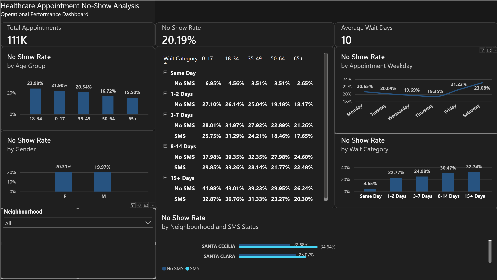

# Healthcare Appointment No-Show Analysis

**Tooling:** Power BI (Desktop), Power Query, DAX  
**Dataset:** 110.5k+ Healthcare Appointment Records (Kaggle)  
**Project Goal:** Identify operational and demographic drivers behind appointment non-attendance and deliver data-backed scheduling recommendations to boost clinic attendance.

---

## Executive Summary

Healthcare appointment no-shows reduce clinical efficiency, underutilize staff, and delay patient care. Analysis of **111K appointments** revealed an overall **No-Show Rate of 20.19%** and an **Average Wait Time of 10 days**. 

Key findings demonstrate that **Wait Category** is the primary operational driver of missed appointments, escalating sharply from **4.65% for Same Day** bookings to **32.74% for 15+ Day** wait times. Furthermore, granular matrix analysis cross-referencing SMS status, age group, and wait tiers reveals that **SMS reminders consistently lower no-show rates across long-lead wait categories**, though their relative efficacy varies by patient age.

---

## Business Problem & Core Objectives

Clinics face substantial financial loss and scheduling disruption when patients fail to attend appointments without prior notice. This project addresses four fundamental operational questions:
1. **Scale:** What is the baseline volume and non-attendance rate across the health system?
2. **Demographic Risk:** Which age groups or patient segments exhibit the highest propensity for absenteeism?
3. **Operational Factors:** How do scheduling lead times (`WaitDays`), calendar days, and SMS notifications impact attendance?
4. **Actionable Mitigation:** What systemic adjustments can clinic management deploy to minimize gaps?

---

## Dashboard Design & Interactive Scalability

To ensure the report serves both executive leadership and local clinic managers, the dashboard was engineered for dynamic, multi-level exploration:
* **Interactive Neighbourhood Filtering:** A global `Neighbourhood` slicer allows stakeholders to transition seamlessly from a system-wide macro view down to localized clinic performance, dynamically recalculating all KPI cards, wait-time distributions, and SMS impact matrices for specific geographic areas.
* **Cross-Filtering & Drill-Down:** Selecting any specific age group, weekday, or wait category cross-filters the surrounding visuals, enabling immediate root-cause investigation without requiring separate static reports for each clinic location.

---

## Data Architecture & Quality Assurance

### Source Data & Anomaly Resolution
* **Initial Volume:** 110,527 raw appointment records.
* **Data Integrity Correction:** Early exploratory validation uncovered a source-level data corruption where all `AppointmentDate` timestamps defaulted to `4/28/2016 8:00 PM`. This caused severe negative anomalies in preliminary `WaitDays` calculations. The dataset was re-extracted and validated at the source level in Power Query prior to downstream modeling.

### Data Transformations (Power Query)
* **Identifier Protection:** Converted `PatientID` and `AppointmentID` to `Text` data types to prevent floating-point compression errors (e.g., scientific notation display) and eliminate improper numerical aggregations.
* **Type Alignment:** Enforced strict `Whole Number` data types on numeric fields (`WaitDays`, `Age`) to support relational DAX comparison functions.

---

## Key Performance Indicators & Dashboard Metrics

### 1. High-Level Metrics
* **Total Appointments:** 111K
* **No-Show Rate:** 20.19%
* **Average Wait Days:** 10 Days

### 2. Lead-Time Impact (No-Show Rate by Wait Category)
* **Same Day:** 4.65%
* **1–2 Days:** 22.77%
* **3–7 Days:** 24.98%
* **8–14 Days:** 30.47%
* **15+ Days:** 32.74%
* *Key Operational Takeaway:* Patients waiting 15 or more days are over **7 times more likely** to miss their appointment than those booking on the same day.

### 3. Patient Demographics & Temporal Trends
* **Age Groups:** Non-attendance is heavily concentrated among younger adults. 
  * **18–34:** 23.98% (Highest risk)
  * **0–17:** 21.90%
  * **35–49:** 20.54%
  * **50–64:** 16.72%
  * **65+:** 15.50% (Lowest risk)
* **Gender Distribution:** Negligible variance between Females (**20.31%**) and Males (**19.97%**).
* **Weekday Variance:** Absenteeism peaks toward the end of the week and on weekends, registering **23.08% on Saturday** and **21.23% on Friday**, compared to a low of **19.35% on Thursday**.

### 4. Cross-Dimensional Matrix Insights (SMS vs. Age vs. Wait Tier)
* **Same-Day Bookings:** Require no SMS intervention, maintaining baseline no-show rates between **2.65% and 6.95%**.
* **8–14 Day Wait Window:** SMS deployment yields measurable attendance improvements across young demographics, reducing no-show rates from **39.35% down to 33.26%** for ages 18–34, and from **37.98% down to 29.85%** for ages 0–17.
* **15+ Day Wait Window:** Reminders help offset extended lead times, dropping no-show rates from **43.01% down to 36.76%** for the high-risk 18–34 cohort.

---

## Strategic Recommendations

1. **Dynamic Overbooking Protocols:**
   * Institute a systematic overbooking or double-booking strategy for appointment slots scheduled **15+ days in advance**, safely absorbing the ~33% expected attrition rate.
   * Protect clinical productivity by reserving **15–20% of daily capacity for Same-Day bookings**, leveraging their ~95% attendance reliability.

2. **Automated, Multi-Stage SMS Workflows:**
   * Prioritize SMS reminders specifically for appointments with lead times **exceeding 3 days**, where notifications successfully suppress no-show rates by **6 to 10 percentage points**.
   * Tailor communication strategies directly toward the **18–34 age demographic**, who represent the highest baseline absenteeism risk (23.98%).

3. **Weekend & Late-Week Staffing Alignment:**
   * Adjust operational workflows and deploy secondary confirmation touchpoints for appointments scheduled on **Fridays and Saturdays**, which experience elevated default rates up to 23.08%.

Adjust operational workflows and deploy secondary confirmation touchpoints for appointments scheduled on Fridays and Saturdays, which experience elevated default rates up to 23.08%.
